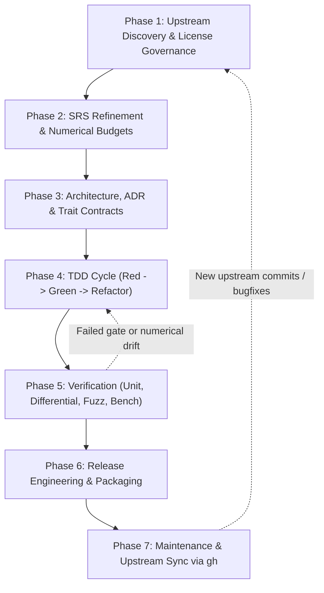

# 01 — Software Development Life Cycle (SDLC)

> **Project:** Alestia (`cybernetics-decentral/Celestia` -> Rust Workspace)  
> **Process Model:** Iterative & Incremental Agile Scrum + Extreme Programming (TDD) + Differential Reference Verification  
> **Companion Docs:** [README.md](./README.md) | [02-SRS.md](./02-SRS.md) | [03-AGILE-SPRINT-PLAN.md](./03-AGILE-SPRINT-PLAN.md) | [04-TDD-RUST-GUIDE.md](./04-TDD-RUST-GUIDE.md)

---

## 1. SDLC Philosophy & Process Model

Porting a ~5.75 MB C++20 3D astronomical simulation engine (`cybernetics-decentral/Celestia` v1.7.0) into Rust requires a disciplined SDLC that prevents silent numerical drift, visual regressions, and scope creep. Alestia combines three complementary practices:

1. **Iterative & Incremental Agile (2-Week Sprints):** Bottom-up delivery along the Cargo crate dependency DAG—starting with deterministic math/time foundations (`alestia-util`, `alestia-math`, `alestia-astro`), moving through ephemerides and catalogs (`alestia-ephem`, `alestia-engine`), then GPU rendering (`alestia-render`), scripting (`alestia-script`), and desktop UI/tools (`alestia-app`, `alestia-tools`).
2. **Test-Driven Development (Red-Green-Refactor):** No production code is merged without a failing test written first. Every C++ unit test in `test/unit/`, integration test in `test/integration/`, and script test in `test/scripts/` has a mandatory Rust test counterpart.
3. **Differential Reference Verification:** Because Celestia already exists as a working C++20 reference (`git@github.com:cybernetics-decentral/Celestia.git`), Alestia treats the C++ implementation and NASA JPL Horizons ephemeris vectors as formal oracles during verification.

---

## 2. End-to-End 7-Phase SDLC



### Phase Matrix

| Phase | Primary Activities | Entry Criteria | Exit Criteria / Artifacts | Owners |
|---|---|---|---|---|
| **1. Upstream Discovery & License Governance** | Inspect `cybernetics-decentral/Celestia` via `gh`; catalog C++ modules, shaders, test fixtures; verify `GPL-2.0-or-later` compatibility of all Rust crate dependencies. | Upstream baseline commit pinned (`134ff29`). | Module inventory, `GPL-2.0-or-later` dependency audit (`cargo-deny` allowlist). | Tech Lead, Maintainers |
| **2. SRS Refinement & Numerical Budgets** | Convert C++ behaviors into testable `FR-*` and `NFR-*` specs; establish numerical tolerances (e.g., AU/mas bounds, sRGB delta-E). | Phase 1 inventory complete. | Updated [02-SRS.md](./02-SRS.md) & traceability matrix (RTM). | Product Owner, Domain Engineer |
| **3. Architecture, ADR & Trait Contracts** | Define crate boundaries, public Rust traits (`Orbit`, `RotationModel`, `AssetLoader`, `RenderBackend`), and `unsafe` isolation boundaries; write Architecture Decision Records (ADRs). | Story meets Definition of Ready (DoR). | Approved ADR in `docs/adr/`, trait signatures without `todo!()` in public API. | Systems Architect |
| **4. TDD Implementation (Red-Green-Refactor)** | Write failing Rust unit/property tests first (**Red**), implement minimal safe Rust to pass (**Green**), refactor for clarity and zero Clippy warnings (**Refactor**). All compilation, clippy, and test execution run exclusively on **GitHub Actions CI/CD** (monitored via `gh run`), with zero local builds required. | Trait contracts & test fixtures ready. | CI/CD passing `cargo fmt --check`, `cargo clippy -- -D warnings`, `cargo nextest run`, and `cargo test --doc`. | Feature Engineers |
| **5. Verification, Differential Testing & Fuzzing** | Run differential tests vs C++ v1.7.0 / JPL Horizons, `cargo-fuzz` on parsers (`.3ds`, `.cmod`, `.ssc`, `.stc`, `.dsc`), `criterion` benchmarks, and headless `wgpu` image diffs. | Unit + integration tests green locally. | >=85% line coverage (`cargo-llvm-cov`), zero sanitizer/Miri issues, benchmark budgets met. | QA / Verification Lead |
| **6. Release Engineering & Packaging** | Tag SemVer release, build cross-platform binaries (Windows x64, Linux x86_64/aarch64, macOS Universal), bundle `CelestiaContent` compatibility checks, generate SBOM. | Sprint Review sign-off & Release Checklist 100% green. | Signed release artifacts, `CHANGELOG.md`, `cargo-audit` clean report. | Release Engineer |
| **7. Maintenance & Upstream Sync** | Monitor `cybernetics-decentral/Celestia` and `CelestiaProject/Celestia` via `gh`, triage regressions, backport critical fixes (e.g., depth partition, bounds checks). | Release live on `master`. | Triage issues opened in Sprint backlog within 48 hours of upstream fix. | Maintainer Rotation |

---

## 3. Git Workflow & Branching Strategy

Alestia uses **Trunk-Based Development** on `master` with short-lived topic branches (`<= 3 days` lifetime):

- **Protected Branch:** `master` requires passing CI status checks, 1+ peer approval, and linear history (squash-and-merge or rebase-merge).
- **Branch Naming Convention:**
  - `feat/<crate>-<short-slug>` (e.g., `feat/util-r128-arithmetic`)
  - `fix/<crate>-<issue-or-slug>` (e.g., `fix/render-ring-depth-partition`)
  - `test/<crate>-<short-slug>` (e.g., `test/model-3ds-fuzz-corpus`)
  - `docs/<topic>` (e.g., `docs/adr-003-wgpu-hdr-pipeline`)
- **Commit Message Format (Conventional Commits):**
  ```text
  <type>(<scope>): <imperative summary>

  [optional body explaining why, referencing Celestia commit/PR if ported]
  Refs: US-S1-03, FR-001
  ```
  Allowed `<type>`: `feat`, `fix`, `test`, `refactor`, `perf`, `docs`, `ci`, `build`, `chore`.

---

## 4. Rust Safety, `unsafe` Code Governance & Licensing Gates

### 4.1 `unsafe` Policy by Crate Tier

| Crate Tier | Crates | Lint Attribute | Rules |
|---|---|---|---|
| **Tier 1 — Pure Domain & Parsers** | `alestia-util`, `alestia-math`, `alestia-astro`, `alestia-model`, `alestia-image`, `alestia-font`, `alestia-engine`, `alestia-core`, `alestia-tools` | `#![forbid(unsafe_code)]` | Zero `unsafe` blocks allowed. Bounds-checked slice/cursor reads (`checked_add`, `get`, `try_into`) replace C++ pointer arithmetic. |
| **Tier 2 — Hardware, Scripting & Optional FFI** | `alestia-ephem`, `alestia-render`, `alestia-script`, `alestia-app` | `#![deny(unsafe_code)]` | `unsafe` permitted only inside isolated FFI/surface modules with `#[allow(unsafe_code)]`, mandatory `// SAFETY:` justification comment, and Miri or AddressSanitizer test coverage. |

### 4.2 `GPL-2.0-or-later` License Compatibility (`cargo-deny`)

Because upstream Celestia is licensed under **GNU GPL v2 or later** (`GPL-2.0-or-later`), Alestia enforces `deny.toml` on every PR:
- **Permitted dependency licenses:** `GPL-2.0`, `GPL-2.0-only`, `GPL-2.0-or-later`, `MIT`, `BSD-2-Clause`, `BSD-3-Clause`, `ISC`, `Zlib`, `Unicode-3.0`, `Apache-2.0` (compatible under `GPL-2.0-or-later` via GPLv3 upgrade path).
- **Prohibited:** Proprietary blobs, `UNLICENSED`, or incompatible copyleft licenses.
- **Automated Gate:** `cargo deny check licenses advisories bans sources` must exit `0` in CI.

---

## 5. CI/CD Quality Gate Pipeline

Every pull request triggers an automated pipeline before human code review completes:


### Mandatory PR Review Checklist

- [ ] **TDD Evidence:** Test commit or diff demonstrates test cases covering happy path, boundary conditions, and malformed input errors.
- [ ] **SRS Traceability:** PR description links `FR-*` / `NFR-*` and `US-S*-*` IDs.
- [ ] **No Silent Panics:** Zero `.unwrap()` / `.expect()` in library crates on runtime/file input; all fallible paths return typed `thiserror` enums.
- [ ] **Documentation:** Public structs, traits, and functions have Rustdoc comments (`#![warn(missing_docs)]` on public APIs) and runnable doc-tests where appropriate.
- [ ] **Resource Safety:** Parsers enforce explicit size/count caps (preventing OOM from malicious `.3ds`/`.cmod`/`.ssc` headers).

---

## 6. Definition of Ready (DoR) & Definition of Done (DoD)

### Definition of Ready (Before Sprint Commitment)

1. User story maps to one or more `FR-*` / `NFR-*` items in [02-SRS.md](./02-SRS.md).
2. Upstream C++ reference files (and test fixtures in `test/` if applicable) are identified.
3. Acceptance criteria include explicit numerical tolerances or structural invariants.
4. Dependencies on earlier crates/stories are resolved or mocked behind a defined Rust trait.
5. Story points are estimated (Fibonacci `1, 2, 3, 5, 8, 13`; stories `> 8` must be split).

### Definition of Done (Before Marking Story Complete)

1. **Red-Green-Refactor** completed; unit and property tests pass on GitHub Actions CI/CD (`cargo nextest run`, verified via `gh run watch` / `gh run view`).
2. Corresponding upstream Celestia tests (from `test/unit/`, `test/integration/`, or `test/scripts/`) pass in Rust on CI/CD.
3. `lint-and-policy` CI job (`cargo fmt --all -- --check`, `cargo clippy --workspace --all-targets -- -D warnings`, `cargo deny check`) passes with zero warnings.
4. Coverage threshold met in CI (`>= 95%` for `alestia-util`, `alestia-math`, `alestia-astro`, `alestia-ephem`; `>= 85%` workspace-wide via `cargo llvm-cov`).
5. Differential comparison against Celestia v1.7.0 (or JPL Horizons) recorded in test fixtures where applicable.
6. Public APIs documented with `///` doc comments and verified by `cargo test --doc` in CI.

---

## 7. Upstream Sync & `gh` Automation Playbook

Engineers track changes in `cybernetics-decentral/Celestia` (and its parent `CelestiaProject/Celestia`) at the start of every sprint using the GitHub CLI (`gh`):

```powershell
# 1. Inspect new commits on cybernetics-decentral/Celestia since baseline 134ff29
gh api "repos/cybernetics-decentral/Celestia/commits?per_page=25" `
  --jq '.[] | "\(.sha[0:7]) \(.commit.author.date) \(.commit.message | split("\n")[0])"'

# 2. Compare a specific upstream commit diff before porting its fix & regression test
gh api "repos/cybernetics-decentral/Celestia/commits/9ef6146" --jq '.files[] | {filename, status, patch}'

# 3. Fetch an upstream test fixture (e.g., test/data/testmodel.cmod) for Rust integration tests
gh api "repos/cybernetics-decentral/Celestia/contents/test/data/testmodel.cmod" `
  --jq '.content' | ForEach-Object { [System.Text.Encoding]::UTF8.GetString([System.Convert]::FromBase64String($_)) }

# 4. List active upstream branches and pull requests for upcoming features
gh api "repos/cybernetics-decentral/Celestia/branches" --jq '.[].name'
gh pr list --repo cybernetics-decentral/Celestia --state open
```

When an upstream bugfix commit arrives (such as `#2785` ring depth partitioning or `#2788` 3DS index bounds rejection), the Sprint Backlog receives a `fix` story containing:
1. A reproduction test written in Rust first (**Red**) matching the upstream failure case.
2. The idiomatic safe-Rust fix (**Green**).
3. Cross-reference to the upstream commit SHA in the commit message and `docs/developer/02-SRS.md` if requirements changed.
