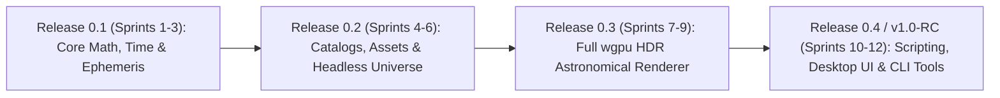

# 03 — Agile Scrum Sprint Plan & Product Backlog

> **Project:** Alestia (`cybernetics-decentral/Celestia` -> Rust Workspace)  
> **Cadence:** 12 Sprints × 2 Weeks (24 Weeks / 4 Major Releases)  
> **Companion Docs:** [README.md](./README.md) | [01-SDLC.md](./01-SDLC.md) | [02-SRS.md](./02-SRS.md) | [04-TDD-RUST-GUIDE.md](./04-TDD-RUST-GUIDE.md)

---

## 1. Agile Governance & Team Structure

### 1.1 Scrum Framework Parameters
- **Sprint Length:** 2 weeks (10 working days).
- **Estimation Scale:** Modified Fibonacci Story Points (`1, 2, 3, 5, 8, 13`); any story estimated at `13` must be decomposed before entering a sprint.
- **Target Team Capacity:** 4 engineers (Systems/Rust Core, Astrodynamics/Ephemeris, Graphics/`wgpu`, Scripting/UI) -> **~35–42 Story Points per Sprint** after 20% buffer for TDD test infrastructure, fuzzing, and upstream sync.
- **Core Ceremonies:**
  - **Sprint Planning (Day 1, 2h):** Confirm DoR, pull stories by dependency order, define Sprint Goal & TDD test targets.
  - **Daily Standup (15m):** Focus on Red/Green blockers, differential mismatches, and integration handoffs.
  - **Backlog Refinement (Day 6, 1h):** Check `cybernetics-decentral/Celestia` via `gh` for upstream fixes; split upcoming epics.
  - **Sprint Review & Demo (Day 10, 1h):** Live demo of working Rust binaries, headless renders, and benchmark/coverage deltas.
  - **Sprint Retrospective (Day 10, 45m):** Inspect velocity, flaky tests, mutation score, and CI turnaround time.

---

## 2. Product Backlog Epics & Release Roadmap

| Epic ID | Title | Target Crates | SRS Coverage | Target Sprints |
|---|---|---|---|---|
| **EP-01** | Workspace Foundation, CI & `alestia-util` | Workspace, `alestia-util` | `FR-001`..`FR-005`, `NFR-003`..`NFR-010` | Sprint 1 |
| **EP-02** | Computational Geometry & Astronomical Time | `alestia-math`, `alestia-astro` | `FR-006`..`FR-009`, `NFR-002` | Sprint 2 |
| **EP-03** | Orbital Mechanics & Ephemeris Engine | `alestia-ephem` | `FR-010`..`FR-015`, `NFR-002` | Sprint 3 |
| **EP-04** | Config, Binary Databases & Text Catalog Loaders | `alestia-core`, `alestia-engine` | `FR-016`..`FR-021` | Sprint 4 |
| **EP-05** | 3D Geometry, Texture Decoders & Font Engine | `alestia-model`, `alestia-image`, `alestia-font` | `FR-022`..`FR-025`, `NFR-003` | Sprint 5 |
| **EP-06** | Simulation Engine, Octrees, Frames & URLs | `alestia-engine`, `alestia-core` | `FR-026`..`FR-031`, `NFR-001` | Sprint 6 |
| **EP-07** | `wgpu` HDR/sRGB Core & Irradiance PSF Stars | `alestia-render` | `FR-032`..`FR-033`, `NFR-001`, `NFR-005` | Sprint 7 |
| **EP-08** | Planetary Bodies, Rings, Atmospheres & CMOD Rendering | `alestia-render` | `FR-034`..`FR-036` | Sprint 8 |
| **EP-09** | DSOs, Guides, Fisheye/WarpMesh & Overlays | `alestia-render` | `FR-037`..`FR-038` | Sprint 9 |
| **EP-10** | Scripting (`.cel`/`.celx`), Desktop App & CLI Tools | `alestia-script`, `alestia-app`, `alestia-tools` | `FR-039`..`FR-046` | Sprints 10–12 |

### 24-Week Release Roadmap

---

## 3. Detailed Sprint-by-Sprint Execution Plan

### Release 0.1 — Core Foundations (Sprints 1–3)

#### Sprint 1: Cargo Workspace, CI Pipeline & `alestia-util` (Target: 36 pts)
- **Sprint Goal:** Establish the 13-crate Cargo workspace, CI/CD gates, and complete `alestia-util` with 100% parity to `test/unit/` utility tests.
- **Dependencies:** None (Greenfield foundation).

| Story ID | User Story | Pts | Acceptance Criteria & TDD Target |
|---|---|---|---|
| **US-S1-01** | As a maintainer, I want a 13-crate Cargo workspace with `nextest`, `clippy`, `fmt`, `llvm-cov`, and `deny.toml` in CI so every PR is gated automatically. | 5 | `cargo test` / `nextest`, `cargo clippy -- -D warnings`, `cargo deny check` pass on Linux/Windows/macOS. |
| **US-S1-02** | As an engine developer, I want `R128` 64.64 fixed-point arithmetic (`FR-001`) so universal coordinates never lose precision. | 8 | Port all cases from `r128_test.cpp` + `proptest` algebraic laws (associativity, round-trip `f64`, Base64). |
| **US-S1-03** | As a catalog author, I want a bounds-checked tokenizer, parser, and `AssociativeArray` (`FR-002`) with file/line errors. | 8 | Port `tokenizer_test.cpp` & `associativearray_test.cpp`; zero panics on truncated/malformed input. |
| **US-S1-04** | As a localization developer, I want `strnatcmp`, Greek substitution, and UTF-8/Unicode normalization (`FR-003`). | 8 | Port `strnatcmp_test.cpp`, `greek_test.cpp`, `unicode_test.cpp` semantics. |
| **US-S1-05** | As a systems developer, I want endian-safe binary I/O, linear/sRGB `Color`, and structured logging (`FR-004`, `FR-005`). | 7 | Port `logger_test.cpp`; verify binary cursor EOF safety and sRGB<->linear accuracy (`1e-6`). |

- **Sprint 1 Demo:** Trigger GitHub Actions CI (`gh run watch --repo Mr-Kumar-Abhishek/Alestia`) and confirm all utility unit, property, doc-test, Clippy, license, and coverage gates pass across Linux, Windows, and macOS.

---

#### Sprint 2: `alestia-math` & `alestia-astro` (Target: 37 pts)
- **Sprint Goal:** Deliver verified 3D geometry primitives, root solvers, Julian/TDB timekeeping, and photometric/unit conversions.
- **Dependencies:** `alestia-util` (Sprint 1).

| Story ID | User Story | Pts | Acceptance Criteria & TDD Target |
|---|---|---|---|
| **US-S2-01** | As a rendering developer, I want `f64`/`f32` vectors, quaternions, frustums, rays, spheres, and ellipsoids (`FR-006`). | 8 | Ray-ellipsoid, sphere-frustum culling, and orthonormal basis unit + `proptest` tests pass. |
| **US-S2-02** | As an ephemeris developer, I want deterministic Newton/Halley/Brent root solvers (`FR-007`). | 5 | Converges to `1e-13` on test polynomials and Kepler benchmark functions; handles `NaN`/`Inf` safely. |
| **US-S2-03** | As a simulation developer, I want Julian Date, `UTC <-> TAI <-> TT <-> TDB`, and `leap-seconds.list` parsing (`FR-008`). | 8 | Port `date_test.cpp` + USNO historical leap-second boundary tests (`1972`–`2026+`). |
| **US-S2-04** | As an astronomer, I want unit conversions (AU, LY, pc, km) and magnitude/irradiance math (`FR-009`). | 8 | Port `astro_test.cpp`; relative error `< 1e-12` vs C++ reference outputs. |
| **US-S2-05** | As a QA engineer, I want a differential test harness comparing Rust outputs against serialized C++ reference JSON/CSV vectors. | 8 | Harness compares 500+ date/astro/math vectors against C++ `134ff29` golden outputs. |

- **Sprint 2 Demo:** Differential report showing zero drift between `alestia-math`/`alestia-astro` and C++ `test/unit/astro_test` & `date_test`.

---

#### Sprint 3: `alestia-ephem` Ephemerides & Rotations (Target: 40 pts)
- **Sprint Goal:** Implement Keplerian, VSOP87, TASS17, sampled `.xyzv`/`.xyzvbin`, JPL DE, and rotational ephemerides.
- **Dependencies:** `alestia-math`, `alestia-astro` (Sprint 2).

| Story ID | User Story | Pts | Acceptance Criteria & TDD Target |
|---|---|---|---|
| **US-S3-01** | As an astrodynamicist, I want elliptical, parabolic, and hyperbolic `KeplerOrbit` + `Orbit` trait (`FR-010`). | 8 | Port `kepler_test.cpp`; verify energy/angular momentum invariants via `proptest`. |
| **US-S3-02** | As a solar system explorer, I want VSOP87 (planets) and TASS17 (Saturnian moons) analytical orbits (`FR-011`). | 8 | Differential tests vs Celestia C++ v1.7.0 across 1900–2100 within `1e-9` AU. |
| **US-S3-03** | As a mission designer, I want `.xyz`/`.xyzv` ASCII & `.xyzvbin` binary sampled orbit loaders with cubic/Hermite interpolation (`FR-012`). | 8 | Round-trip `.xyzv` <-> `.xyzvbin` within `1e-7` km; malformed header errors tested. |
| **US-S3-04** | As a researcher, I want JPL binary DE405/430/440 Chebyshev reader (`FR-013`) and IAU precession/nutation rotation models (`FR-014`). | 8 | JPL testpo vector validation within `1e-12` AU; rotation quaternions match C++ within `1e-8` rad. |
| **US-S3-05** | As a spacecraft simulation user, I want optional feature-gated NAIF SPICE orbit/rotation bindings (`FR-015`). | 8 | `--features spice` compiles behind `#![deny(unsafe_code)]` FFI wrapper and passes gated test. |

- **Sprint 3 Demo:** Release `0.1.0-alpha` — CLI ephemeris dump of Earth, Saturn, and Voyager matching JPL Horizons & Celestia C++.

---

### Release 0.2 — Catalogs, Assets & Headless Universe (Sprints 4–6)

#### Sprint 4: `celestia.cfg` & Catalog Loaders (Target: 39 pts)
- **Sprint Goal:** Parse `celestia.cfg` and load all binary/text Star, Solar System, and Deep Sky catalogs.
- **Dependencies:** `alestia-util` (S1), `alestia-ephem` (S3).

| Story ID | User Story | Pts | Acceptance Criteria & TDD Target |
|---|---|---|---|
| **US-S4-01** | As a user, I want `celestia.cfg` parsing with all v1.7.0 flags (`SRGBRendering`, `ToneMappingMode`, `ProjectionMode`, etc.) (`FR-016`). | 8 | Loads upstream `celestia.cfg.in` cleanly; unit tests cover defaults and overrides. |
| **US-S4-02** | As an astronomer, I want `stars.dat`, `starnames.dat`, and HD/SAO cross-index binary loaders (`FR-017`). | 8 | Resolves HIP/HD/SAO and Bayer/Flamsteed aliases identically to C++. |
| **US-S4-03** | As an add-on creator, I want `.stc` star catalog loader & `StellarClass` parser (`FR-018`). | 8 | Port `stellarclass_test.cpp`; loads `test/data/nearstars.stc` with `Add`/`Replace`/`Modify`. |
| **US-S4-04** | As an add-on creator, I want `.ssc` solar system & multi-phase `Timeline` loader (`FR-019`). | 8 | Port `loader_validation_test.cpp`; handles rings, atmospheres, locations, and timeline phases. |
| **US-S4-05** | As an astronomer, I want `.dsc` deep sky catalog, `asterisms.dat`, `boundaries.dat`, and `Category` tags (`FR-020`, `FR-021`). | 7 | Port `constellation_test.cpp` & `category_test.cpp`. |

- **Sprint 4 Demo:** Load complete `CelestiaContent` dataset in < 1.5s and print catalog statistics in headless Rust CLI.

---

#### Sprint 5: Models, Images & Fonts (`alestia-model`, `alestia-image`, `alestia-font`) (Target: 38 pts)
- **Sprint Goal:** Implement memory-safe `.cmod`/`.3ds` loaders, image decoders, virtual texture tiles, and font rasterization.
- **Dependencies:** `alestia-util`, `alestia-math`.

| Story ID | User Story | Pts | Acceptance Criteria & TDD Target |
|---|---|---|---|
| **US-S5-01** | As a 3D artist, I want CMOD ASCII & binary parser/writer with all vertex attributes & materials (`FR-022`). | 8 | Port `cmod_bin_ascii_roundtrip_test.cpp` on `testmodel.cmod` and `testmodel.cmod.txt`. |
| **US-S5-02** | As a security-conscious user, I want a bounds-checked `.3ds` loader rejecting out-of-range indices (`FR-023`). | 8 | Port `3ds_load_test.cpp` (`icosphere.3ds`) + regression tests for `#2788` + `cargo-fuzz` target. |
| **US-S5-03** | As a texture author, I want PNG, JPEG, DDS (DXT1/3/5), and optional AVIF decoders (`FR-024`). | 8 | Decodes RGB/RGBA/alpha/DXT textures with explicit linear vs sRGB color metadata. |
| **US-S5-04** | As a planet builder, I want `.ctx` Virtual Texture level/tile resolver and async tile cache (`FR-024`, `FR-030`). | 7 | Resolves tile coordinates for LOD 0..12 without blocking main thread. |
| **US-S5-05** | As an international user, I want TrueType/OpenType font atlas and LTR/RTL layout engine (`FR-025`). | 7 | Rasterizes Latin, Greek, and RTL text bounds deterministically. |

- **Sprint 5 Demo:** Fuzz `.3ds` & `.cmod` parsers for 1M+ iterations with zero panics and pass round-trip integration suite.

---

#### Sprint 6: Simulation Engine, Octrees & `cel://` URLs (`alestia-engine`, `alestia-core`) (Target: 41 pts)
- **Sprint Goal:** Deliver the complete headless `Universe`, `Simulation`, `Observer`, spatial octrees, `DepthPartition`, and `cel://` state URLs.
- **Dependencies:** Sprints 3, 4, 5.

| Story ID | User Story | Pts | Acceptance Criteria & TDD Target |
|---|---|---|---|
| **US-S6-01** | As an explorer, I want `UniversalCoord` and all 6 observer reference frames + `TwoVector` frames (`FR-026`). | 8 | Sub-millimeter precision near spacecraft and zero jitter at galactic distances. |
| **US-S6-02** | As a renderer, I want `StarOctree` and `DSOOctree` spatial indexing with deterministic magnitude culling (`FR-027`). | 8 | Port `staroctree_test.cpp` & `dsooctree_test.cpp` (including `#2776` boundary determinism). |
| **US-S6-03** | As a user, I want `Simulation` time scale, `Goto`/SLERP camera interpolation, `Follow`, `SyncOrbit`, and light-time toggle (`FR-028`). | 8 | Deterministic headless simulation tests verify arrival coordinates and time ticks. |
| **US-S6-04** | As a renderer, I want `DepthPartition` interval splitting with planetary ring far-clipping preservation (`FR-029`). | 8 | Port `depthpartition_test.cpp` + regression tests for `#2785` & `#2786`. |
| **US-S6-05** | As a user, I want `cel://` URL serialization, ray-pick `Selection`, `Completion`, and `EclipseFinder` (`FR-030`, `FR-031`). | 9 | Port `resourcesystem_test.cpp`; `cel://` round-trip and historical eclipse prediction pass. |

- **Sprint 6 Demo:** Release `0.2.0-alpha` — Headless `alestia-core` loads a `cel://` URL, advances simulation 100 years, and prints visible stars/eclipses.

---

### Release 0.3 — `wgpu` Astronomical Renderer (Sprints 7–9)

#### Sprint 7: `wgpu` Pipeline, Linear HDR/sRGB & Irradiance PSF Stars (Target: 39 pts)
- **Sprint Goal:** Stand up the `wgpu` rendering engine, linear-light HDR + exponential sRGB tone-mapping post-process, and irradiance PSF star rendering.
- **Dependencies:** `alestia-engine`, `alestia-image`, `alestia-font` (Sprints 5–6).

| Story ID | User Story | Pts | Acceptance Criteria & TDD Target |
|---|---|---|---|
| **US-S7-01** | As a graphics developer, I want `wgpu` device/swapchain abstraction supporting headless Lavapipe/WARP tests (`NFR-005`). | 8 | Renders offscreen `Rgba16Float` framebuffers in CI without a physical display. |
| **US-S7-02** | As a graphics developer, I want linear HDR `SRGBRendering` + `ToneMappingMode` (`Off`/`Manual`) + `post_srgb.wgsl` (`FR-032`). | 8 | Verifies exact $1 - \exp(-E \cdot L)$ tone-mapping curve and `#2794` overlay colorspace fix. |
| **US-S7-03** | As an astronomer, I want irradiance-based PSF point/large star & glare shaders (`FR-033`, `#2781`). | 13 -> **Split:** (5) CPU irradiance/PSF math (`psf_test.cpp`); (8) `psf_star.wgsl` & `psf_glow.wgsl` pass. | Port `psf_test.cpp` + `rendcontext_test.cpp`; headless starfield render matches golden image. |
| **US-S7-04** | As a user, I want depth-partitioned multi-interval render queue orchestration (`FR-029`, `FR-032`). | 8 | Back-to-front depth intervals clear depth buffer cleanly without Z-fighting. |

- **Sprint 7 Demo:** Headless and windowed real-time Milky Way starfield rendered via `wgpu` with exposure toggle.

---

#### Sprint 8: Planetary Surfaces, Rings, Atmospheres & CMOD Meshes (Target: 40 pts)
- **Sprint Goal:** Render solid/gas planets, virtual textures, eclipse shadows, optical-depth rings, Rayleigh/Mie atmospheres, CMOD models, and comets.
- **Dependencies:** Sprint 7.

| Story ID | User Story | Pts | Acceptance Criteria & TDD Target |
|---|---|---|---|
| **US-S8-01** | As an explorer, I want `LodSphereMesh` planets with diffuse, normal, specular, night-light, and cloud layers (`FR-034`). | 8 | Multi-light + eclipse umbra/penumbra shader test passes golden Earth-Moon snapshot. |
| **US-S8-02** | As an explorer, I want Virtual Texture (`.ctx`) GPU tile streaming integrated into planetary LODs (`FR-024`, `FR-034`). | 8 | High-res tile swap occurs asynchronously with `< 4 ms` frame variance (`NFR-004`). |
| **US-S8-03** | As an explorer, I want planetary rings with mutual ring/planet shadows and `#2785`/`#2786` partition safety (`FR-035`). | 8 | Saturn ring transit render passes golden image diff with zero far-clipping artifacts. |
| **US-S8-04** | As an explorer, I want Rayleigh/Mie atmospheric limb scattering (`FR-035`). | 8 | Earth/Mars horizon scattering passes `atmosphere.celx` visual parity check. |
| **US-S8-05** | As an explorer, I want CMOD/3DS mesh rendering (`#2784` sRGB material fix) and comet tails (`FR-036`). | 8 | ISS/asteroid `.cmod` & comet tail render match golden snapshots without washed-out materials. |

- **Sprint 8 Demo:** Interactive orbital flyby around Earth-Moon and Saturn's rings at `>= 60 FPS`.

---

#### Sprint 9: Deep Sky Objects, Guides, Fisheye & WarpMesh (Target: 36 pts)
- **Sprint Goal:** Complete all DSO renderers, astronomical grids/boundaries/markers, dome `fisheye` projection, and `warpmesh` post-processing.
- **Dependencies:** Sprint 8.

| Story ID | User Story | Pts | Acceptance Criteria & TDD Target |
|---|---|---|---|
| **US-S9-01** | As an astronomer, I want `galaxy`, `globular`, `opencluster`, and `nebula` DSO renderers (`FR-037`). | 8 | Irradiance-scaled Andromeda/Orion renders match C++ reference within perceptual threshold. |
| **US-S9-02** | As an educator, I want `asterisms`, constellation `boundaries`, `skygrid`s, `planetgrid`s, `eclipticline`, `markers`, and `referencemark`s (`FR-037`). | 8 | Every render flag toggles its layer cleanly; line anti-aliasing verified. |
| **US-S9-03** | As a planetarium operator, I want `fisheye` projection mode and Paul Bourke `.map` `warpmesh` post-process (`FR-038`). | 8 | Automated UV grid test verifies exact control-point mapping for `warpmesh`. |
| **US-S9-04** | As a user, I want 2D `text.wgsl`, `crosshair`, `selpointer`, and linear/sRGB-correct image overlays (`FR-032`, `FR-037`). | 7 | Text & image overlays match `#2794` gamma-correct compositing. |
| **US-S9-05** | As a graphics QA engineer, I want a full `alestia-render` golden snapshot regression suite running on CI. | 5 | 15+ deterministic camera scenes compared via SSIM/RMSE on every graphics PR. |

- **Sprint 9 Demo:** Release `0.3.0-beta` — Full visual parity across Solar System, DSOs, sky grids, and dome fisheye mode.

---

### Release 0.4 / v1.0-RC — Scripting, Desktop App & CLI Tools (Sprints 10–12)

#### Sprint 10: `.cel` & `.celx` Lua Scripting Engine (`alestia-script`) (Target: 37 pts)
- **Sprint Goal:** Execute legacy `.cel` scripts and sandboxed `.celx` Lua scripts with full Celestia API parity.
- **Dependencies:** `alestia-engine` (S6), `alestia-render` (S9).

| Story ID | User Story | Pts | Acceptance Criteria & TDD Target |
|---|---|---|---|
| **US-S10-01** | As a script author, I want the `.cel` legacy command parser & coroutine execution engine (`FR-039`). | 8 | Port `legacy_cmdparser_test.cpp` + pass all 8 `.cel` scripts in `test/scripts/`. |
| **US-S10-02** | As a script author, I want sandboxed Lua runtime (`mlua`) with `celestia`, `observer`, `object`, `position`, `rotation`, `vector`, `frame`, `phase`, `category` (`FR-040`). | 13 -> **Split:** (8) Core Lua VM + `celestia`/`observer`/`object`/`vector`; (5) `position`/`rotation`/`frame`/`phase`/`category`. | Memory/instruction-bounded sandbox; zero C-pointer UB. |
| **US-S10-03** | As a QA engineer, I want all 12 upstream `.celx` test scripts executed in automated integration tests (`FR-040`). | 8 | `StarColorGet`, `StarColorSet_*`, `absmag`, `atmosphere`, `constellation_color`, `distanceto`, `loadfragment`, `pause`, `planet_rings`, `verbosity`, `version` all pass. |
| **US-S10-04** | As a planetarium author, I want safe `celx_gl` 2D overlay drawing bindings (`FR-041`). | 8 | `scripts/overlay/` & `mark-lg.celx` render cleanly via `alestia-render` overlay queue. |

- **Sprint 10 Demo:** Automated execution of all 20 upstream `test/scripts/*.cel*` scenarios in CI.

---

#### Sprint 11: Native Desktop UI, Browsers & Optional Media (`alestia-app`) (Target: 39 pts)
- **Sprint Goal:** Deliver the cross-platform `winit` + `egui` desktop application with split views, object browsers, HUD, and optional audio/video features.
- **Dependencies:** Sprints 9, 10.

| Story ID | User Story | Pts | Acceptance Criteria & TDD Target |
|---|---|---|---|
| **US-S11-01** | As a user, I want `winit` + `egui` main window, split-screen `ViewManager`, keyboard/mouse navigation, and `Enter` autocomplete (`FR-042`). | 8 | All standard Celestia shortcuts (`G`, `C`, `F`, `T`, `Space`, `J`/`K`/`L`) tested via synthetic input events. |
| **US-S11-02** | As a user, I want the HUD telemetry overlay supporting `metric`/`imperial`, `K`/`C`/`F`, and `ltr`/`rtl` layouts (`FR-042`, `NFR-006`). | 7 | Snapshot & formatter tests cover all unit/temperature/layout combinations. |
| **US-S11-03** | As an explorer, I want Star Browser (Nearest/Brightest/With Planets), Solar System Browser, DSO Browser, Tour Guide, and Bookmarks (`FR-043`). | 8 | UI state tests verify sorting, filtering, selection, and `favorites.cel` persistence. |
| **US-S11-04** | As an astronomer, I want the Eclipse/Event Finder dialog and Go To Object / Set Time dialogs (`FR-043`). | 8 | Dialog state tests trigger `EclipseFinder` and jump simulation to eclipse midpoint. |
| **US-S11-05** | As a content creator, I want feature-gated audio playback (`audio`) and video capture (`video`) (`FR-044`). | 8 | `--features audio,video` compiles cleanly; headless frame capture test outputs valid frame sequence. |

- **Sprint 11 Demo:** Interactive desktop exploration of Earth, Saturn, Andromeda, and running Tour Guide with live HUD.

---

#### Sprint 12: CLI Tools, Profiling, Security Audit & v1.0-RC Release (Target: 36 pts)
- **Sprint Goal:** Complete `alestia-tools`, meet all `NFR-*` performance/fuzz/coverage budgets, run full differential parity audit, and cut `v1.0.0-rc.1`.
- **Dependencies:** Sprints 1–11.

| Story ID | User Story | Pts | Acceptance Criteria & TDD Target |
|---|---|---|---|
| **US-S12-01** | As an add-on developer, I want `3dstocmod`, `cmodfix`, and `cmodsphere` CLI subcommands (`FR-045`). | 8 | Golden-file CLI tests match `src/tools/cmod/` outputs on `icosphere.3ds` and `testmodel.cmod`. |
| **US-S12-02** | As a data engineer, I want `xyzv2bin`, `stardb`, `xindex`, and optional `spice2xyzv` CLI tools (`FR-046`). | 8 | Generated binary `.xyzvbin`/`.dat` files load identically in Alestia and Celestia C++. |
| **US-S12-03** | As a performance engineer, I want `criterion` benchmark validation and frame-budget profiling (`NFR-001`, `NFR-004`). | 7 | Startup `< 2.0 s`, 1080p Earth/Milky Way frame time `< 16.6 ms`, `p99 - p50 < 4 ms`. |
| **US-S12-04** | As a security/QA lead, I want 24-hour `cargo-fuzz` soak + `cargo-mutants` + `cargo-audit` + `cargo-deny` sign-off (`NFR-003`, `NFR-008`, `NFR-010`). | 8 | Zero fuzz crashes, mutation score `>= 80%` on core parsers, zero license/advisory issues. |
| **US-S12-05** | As a release manager, I want Windows/Linux/macOS release bundles, SBOM, and `v1.0.0-rc.1` tag. | 5 | Cross-platform artifacts smoke-tested against `CelestiaContent`. |

- **Sprint 12 Demo:** `v1.0.0-rc.1` Release Review — complete walkthrough of parity scorecard, benchmarks, and multi-OS binaries.

---

## 4. Risk Register & Mitigation

| Risk ID | Description | Likelihood | Impact | Mitigation Strategy |
|---|---|---|---|---|
| **RSK-01** | Floating-point divergence in VSOP87/TASS17/Kepler causes drift vs C++ Celestia. | Medium | High | Lock `f64` evaluation order where needed; run Sprint 2–3 differential tests vs C++ `134ff29` & JPL Horizons. |
| **RSK-02** | `wgpu` shader behavior differs across DX12, Vulkan, Metal, and GLES3 backends. | Medium | High | Write portable WGSL (no vendor extensions), run headless Lavapipe (Linux) and WARP (Windows) snapshot tests in CI. |
| **RSK-03** | `CelestiaContent` real-world add-ons rely on permissive legacy `.ssc`/`.stc`/`.cel` quirks. | High | Medium | Port `loader_validation_test.cpp` + test against full `CelestiaContent` repository early in Sprint 4. |
| **RSK-04** | `mlua` coroutine yield/resume semantics differ from C++ Lua C API for `.celx` scripts. | Medium | Medium | Prototype coroutine tick scheduler in Sprint 10 Spike and gate on all 12 upstream `.celx` scripts. |
| **RSK-05** | `GPL-2.0-or-later` dependency incompatibility introduced by a new Rust crate. | Low | High | Enforce `cargo deny check licenses` on every PR in CI from Sprint 1 Day 1. |
| **RSK-06** | Optional C FFI (`cspice`, `ffmpeg`) introduces UB or build fragility on Windows/macOS. | Medium | Medium | Isolate behind Cargo feature flags (`default = []`), wrap with `#[deny(unsafe_code)]`, test via dedicated CI job. |

---

## 5. Agile & TDD Metrics Dashboard

Tracked automatically at every Sprint Review:

| Metric | Target | Measurement Tool |
|---|---|---|
| **Sprint Velocity** | `35–42 pts/sprint` (stabilized after Sprint 2) | GitHub Projects / Sprint Board |
| **Line & Branch Coverage** | `>= 95%` (Core Math/Ephem/Util), `>= 85%` (Workspace) | `cargo llvm-cov --lcov` |
| **Mutation Testing Score** | `>= 80%` on `alestia-util`, `alestia-ephem`, `alestia-model` | `cargo mutants` |
| **Upstream Test Parity** | `22/22` unit, `2/2` integration, `20/20` scripts passing | `cargo test` / `cargo nextest run` |
| **Fuzzing Stability** | `0` panics / OOMs across 10M+ parser executions | `cargo fuzz` (libFuzzer) |
| **1080p Frame Time (`p95`)** | `<= 16.6 ms` (`>= 60 FPS`) | `criterion` + GPU timestamp queries |
| **CI Pipeline Duration** | `<= 12 min` per PR | GitHub Actions timing metrics |
