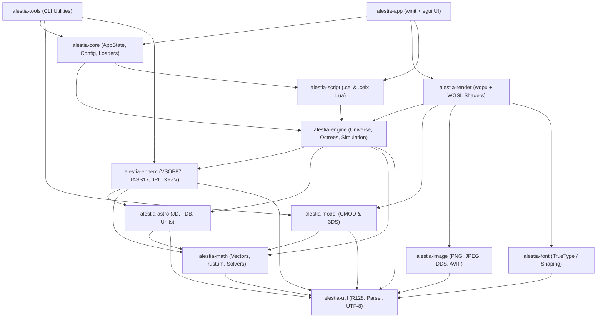

# Alestia Developer Documentation Hub

> **Project:** Alestia — Memory-Safe, Test-Driven Rust Port & Re-Engineering of Celestia  
> **Upstream Source:** `git@github.com:cybernetics-decentral/Celestia.git` ([`cybernetics-decentral/Celestia`](https://github.com/cybernetics-decentral/Celestia))  
> **Baseline Version:** Celestia `1.7.0` (`master` @ `134ff29`, 2026-11-23/24)  
> **Target Toolchain:** Rust `1.95.0+` (`rustc 1.95.0` / `cargo 1.95.0`, Edition 2024)  
> **License:** GNU General Public License v2.0 or later (`GPL-2.0-or-later`)

---

## 1. Purpose & Project Charter

**Alestia** is a clean, modular, Test-Driven Development (TDD) re-engineering of **Celestia** (`cybernetics-decentral/Celestia`), a real-time 3D space simulation and astronomical visualization engine, into a **Rust Cargo Workspace**.

Alestia preserves full data and behavioral compatibility with upstream Celestia v1.7.0 and `CelestiaContent` catalogs (`.ssc`, `.stc`, `.dsc`, `stars.dat`, `starnames.dat`, `asterisms.dat`, `boundaries.dat`, `.cmod`, `.3ds`, `.cel`, `.celx`, `cel://`, `celestia.cfg`), while eliminating C++ memory-safety hazards, replacing global mutable state with explicit dependency-injected traits, modernizing GPU rendering onto `wgpu`/WGSL, and enforcing strict TDD gates on every commit.

---

## 2. Upstream Provenance & Baseline Snapshot

Metadata retrieved directly from `cybernetics-decentral/Celestia` via `gh`:

| Attribute | Verified Value |
|---|---|
| **SSH Clone URI** | `git@github.com:cybernetics-decentral/Celestia.git` |
| **HTTPS URL** | `https://github.com/cybernetics-decentral/Celestia` |
| **Fork Parent** | `CelestiaProject/Celestia` |
| **Default Branch** | `master` |
| **Baseline Commit** | `134ff29` (*"Image format loaders return unique_ptr"*, 2026-11-23) |
| **Project Version** | `1.7.0` (from `CMakeLists.txt`) |
| **License** | GNU General Public License v2.0 or later (`GPL-2.0-or-later`, verbatim `COPYING`) |
| **Primary Language** | C++20 (~5.75 MB), with C, GLSL, CMake, Python, Perl, HTML, Shell |
| **Upstream `src/` Subsystems** | 13 directories (`celutil`, `celmath`, `celastro`, `celephem`, `cel3ds`, `celmodel`, `celimage`, `celttf`, `celengine`, `celrender`, `celscript`, `celestia`, `tools`) |
| **Upstream Shaders** | 30 GLSL files (15 vertex/fragment pairs in `shaders/`) |
| **Upstream Test Suite** | 22 unit tests (`test/unit/`), 2 integration tests (`test/integration/`), 20 script tests (`test/scripts/`) |

### Key Upstream Engineering Advances Captured in Baseline `134ff29`

- **Irradiance-based point-source & deep-sky rendering** (`#2781`, commit `919616a`).
- **Linear-light `SRGBRendering` pipeline** with exponential `ToneMappingMode` (`Off`/`Manual`), `ToneMappingExposure`, and overlay colorspace fixes (`#2794`, `#2784`, `#2787`).
- **Depth partitioning precision fixes** around planetary rings and far-clipping intervals (`#2785`, `#2786`).
- **Strict 3DS mesh bounds validation** rejecting out-of-range vertex/face indices (`#2788`, commit `9ef6146`).

---

## 3. Cargo Workspace Architecture (C++ to Rust Mapping)

Alestia decomposes Celestia's 13 C++ subdirectories into 13 focused Cargo crates organized in a strict acyclic dependency graph:

| # | Rust Workspace Crate | Upstream C++ Source (`file count`) | Core Responsibilities | `unsafe` Policy |
|---|---|---|---|---|
| 1 | `alestia-util` | `src/celutil` (`59`) | `R128` 64.64 fixed-point math, tokenizer, `AssociativeArray`, parser, binary I/O, `strnatcmp`, Greek/UTF-8, logger, formatters, color | `#![forbid(unsafe_code)]` |
| 2 | `alestia-math` | `src/celmath` (`14`) | Vector/matrix/quaternion helpers, frustum, ray, sphere, ellipsoid, intersections, root solvers, PRNG | `#![forbid(unsafe_code)]` |
| 3 | `alestia-astro` | `src/celastro` (`7`) | Julian Date / TDB / UTC, NIST leap seconds, astronomical units, magnitude/luminosity conversions | `#![forbid(unsafe_code)]` |
| 4 | `alestia-ephem` | `src/celephem` (`40`) | Keplerian orbits, VSOP87, TASS17, JPL DE ephemerides, precession/nutation, `.xyzv`/sampled/scripted orbits, optional SPICE FFI | `#![deny(unsafe_code)]` |
| 5 | `alestia-model` | `src/cel3ds` (`5`), `src/celmodel` (`9`) | Bounds-checked `.3ds` reader, CMOD ASCII/binary reader & writer, mesh/material model | `#![forbid(unsafe_code)]` |
| 6 | `alestia-image` | `src/celimage` (`12`) | PNG, JPEG, DDS (DXT1/3/5 decompression), optional AVIF, pixel format & sRGB/linear conversion | `#![forbid(unsafe_code)]` |
| 7 | `alestia-font` | `src/celttf` (`3`) | TrueType/OpenType font atlas generation, SDF/bitmap glyph rasterization, LTR/RTL shaping | `#![forbid(unsafe_code)]` |
| 8 | `alestia-engine` | `src/celengine` (`182`) | `Universe`, `Simulation`, `Observer`, `UniversalCoord`, `FrameTree`, `StarOctree`/`DSOOctree`, `Body`/`SolarSystem`, `DepthPartition`, `Timeline`, `ResourceSystem`, `cel://` URLs | `#![forbid(unsafe_code)]` |
| 9 | `alestia-render` | `src/celrender` (`42`), `shaders/` (`30`) | `wgpu`/WGSL pipelines, linear HDR + sRGB tone mapping, irradiance PSF stars, atmospheres, rings, shadows, DSOs, `perspective`/`fisheye`/`warpmesh` | `#![deny(unsafe_code)]` |
| 10 | `alestia-script` | `src/celscript` (`47`) | Legacy `.cel` command parser/executor and sandboxed Lua `.celx` runtime (`mlua`) | `#![deny(unsafe_code)]` |
| 11 | `alestia-core` | `src/celestia` (`core`) | `AlestiaCore` orchestration, `celestia.cfg` loader, `.stc`/`.ssc`/`.dsc` catalog loaders, `EclipseFinder`, bookmarks, views, HUD state | `#![forbid(unsafe_code)]` |
| 12 | `alestia-app` | `src/celestia/qt` & `sdl` (`173` total in `celestia`) | Native desktop shell (`winit` + `egui`), Star/DSO/SolarSystem browsers, event finder, optional audio (`rodio`/`cpal`) & video capture | `#![deny(unsafe_code)]` |
| 13 | `alestia-tools` | `src/tools` (`66`) | CLI tools: `3dstocmod`, `cmodfix`, `cmodsphere`, `xyzv2bin`, `spice2xyzv`, `stardb`, `xindex`, `vsop`, `atmosphere` | `#![forbid(unsafe_code)]` |

### Crate Dependency DAG

---

## 4. Developer Documentation Suite

| Document | Scope & Audience | Link |
|---|---|---|
| **01 — SDLC** | 7-phase Software Development Life Cycle, Rust quality gates, `unsafe` governance, Git workflow, DoR/DoD, and `gh` upstream sync playbook. | [01-SDLC.md](./01-SDLC.md) |
| **02 — SRS** | IEEE 830 / ISO 29148 Software Requirements Specification: 46 Functional Requirements, 10 Non-Functional Requirements, External Interfaces, and RTM. | [02-SRS.md](./02-SRS.md) |
| **03 — Agile Sprint Plan** | 10 Epics across 4 Releases and 12 two-week Sprints (24 weeks), detailed User Stories, Story Points, Acceptance Criteria, Risk Register, and Metrics. | [03-AGILE-SPRINT-PLAN.md](./03-AGILE-SPRINT-PLAN.md) |
| **04 — Rust TDD Guide** | Red-Green-Refactor CLI loop, Cargo workspace & crate stack, 6-layer test pyramid, 22+2+20 Celestia test port map, 4 full Rust TDD walkthroughs, and CI blueprint. | [04-TDD-RUST-GUIDE.md](./04-TDD-RUST-GUIDE.md) |

### Recommended Reading Order

1. Start with **[01-SDLC.md](./01-SDLC.md)** to understand how engineering work flows from upstream tracking to CI-gated merges.
2. Read **[02-SRS.md](./02-SRS.md)** to review exact functional behavior, numerical tolerances, and shader/format parity contracts.
3. Consult **[03-AGILE-SPRINT-PLAN.md](./03-AGILE-SPRINT-PLAN.md)** to pick up sprint stories and verify dependencies.
4. Follow **[04-TDD-RUST-GUIDE.md](./04-TDD-RUST-GUIDE.md)** daily when writing tests first, implementing crates, and running local verification gates.
